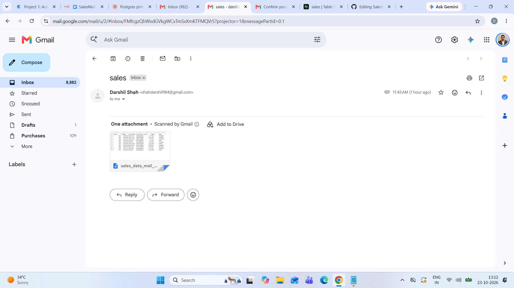
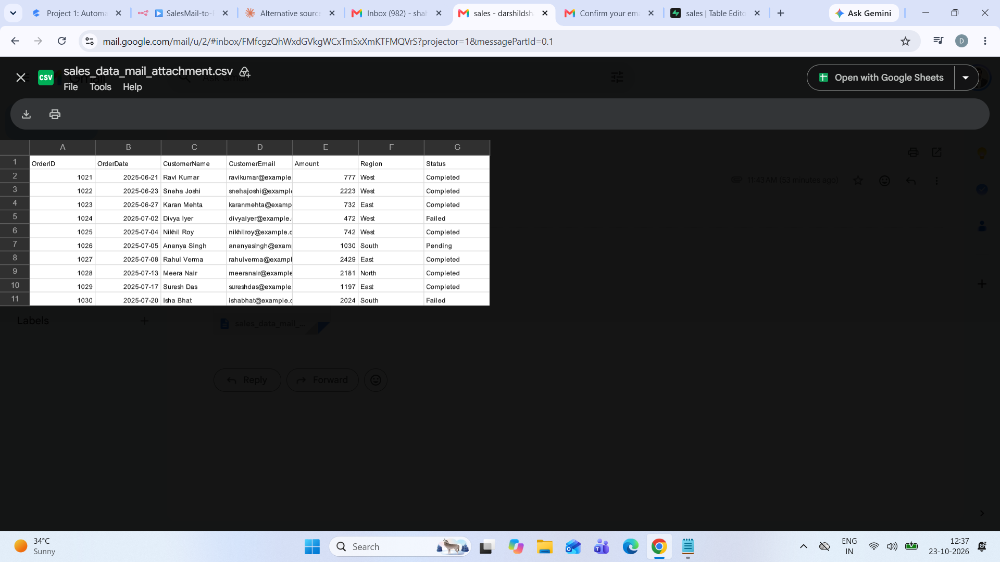
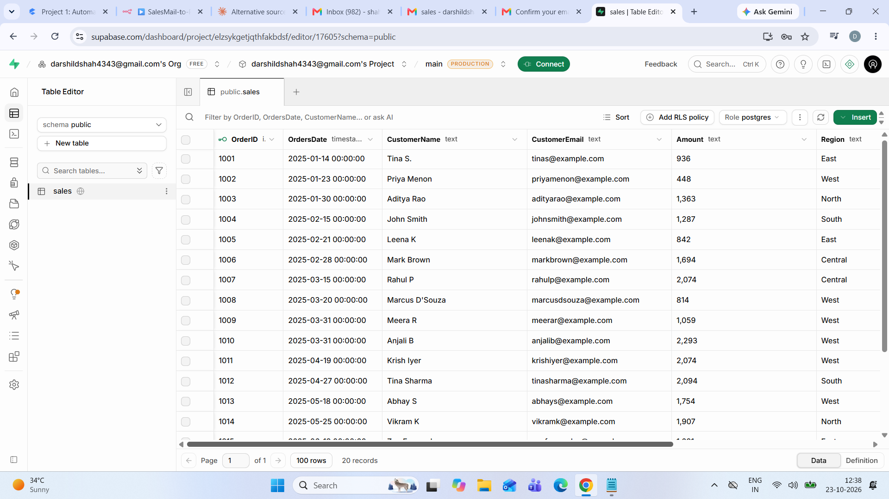
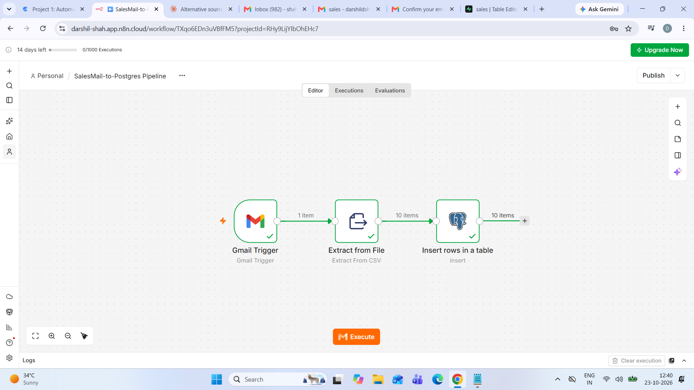
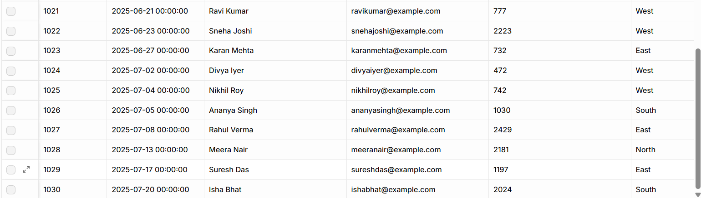

# SalesMail-to-Postgres-Pipeline-Workflow-Automation

> An **n8n** automation that watches Gmail for sales emails, reads the attached **CSV**, and appends the rows into a **Supabase (PostgreSQL)** table, with **no manual imports**.


## 🎥 Demo

**[▶ Watch the 1-minute demo](https://github.com/Darshilshah0203/SalesMail-to-Postgres-Pipeline---Workflow-Automation/blob/main/SalesMail-to-Postgres-Pipeline-Workflow-Automation.mp4)**

---

## 📑 Table of Contents
1. [Problem](#-problem)
2. [Solution](#-solution)
3. [Architecture](#-architecture)
4. [Tech Stack](#-tech-stack)
5. [Walkthrough](#-walkthrough)
6. [Workflow Nodes](#-workflow-nodes)
7. [Database Schema](#-database-schema)
8. [Setup Guide](#-setup-guide)
9. [Challenges and Fixes](#-challenges-and-fixes)
10. [Results](#-results)
11. [Limitations and Next Steps](#-limitations-and-next-steps)
12. [Repo Structure](#-repo-structure)
13. [Acknowledgements](#-acknowledgements)

---

## ❓ Problem

Sales data arrives by email as **CSV attachments**. Someone has to download each file, open it, and import it into the database by hand. This is **slow and repetitive**, and it invites mistakes such as **missed files, wrong columns, or double imports**.

## 💡 Solution

A low-code n8n workflow that does the whole job automatically:

1. **Watches** the Gmail inbox for emails with **"sales"** in the subject
2. **Downloads** the CSV attachment
3. **Parses** the CSV into structured rows using the header row
4. **Inserts** the rows into a PostgreSQL table on Supabase

New data lands in the database within minutes of the email arriving.

## 🏗️ Architecture

```
Gmail Inbox ──► Gmail Trigger ──► Extract from File (CSV) ──► Postgres (Insert) ──► Supabase `sales` table
(subject: sales)   (1 item)            (10 items)                (10 items)
```

## 🧰 Tech Stack

| Layer | Tool |
|---|---|
| **Orchestration** | n8n Cloud |
| **Source** | Gmail (trigger + attachment download) |
| **Parsing** | n8n *Extract from File* (CSV) |
| **Database** | PostgreSQL on Supabase |
| **Version control** | Git and GitHub |

## 🖼️ Walkthrough

### 1. Email arrives with the CSV attached
An email with the subject **`sales`** and a CSV attachment lands in the inbox.



### 2. The CSV contents
The attachment contains **10 new orders** (OrderID **1021 to 1030**).



### 3. Database before the automation
The `sales` table holds **20 records** (OrderID 1001 to 1020).



### 4. The n8n workflow
Three nodes: **1 email in → 10 rows parsed → 10 rows inserted**.



### 5. Database after the automation
The table now holds **30 records**, with the 10 new orders appended.



## 🔧 Workflow Nodes

| # | Node | Purpose | Key settings |
|---|---|---|---|
| 1 | **Gmail Trigger** | Polls the inbox for new matching emails | Event: **Message Received**, Simplify: **off**, Label: **INBOX**, Search: **`subject:sales has:attachment`**, Option: **Download Attachments** on |
| 2 | **Extract from File** | Converts the CSV binary into JSON rows | Operation: **Extract From CSV**, header row enabled, binary property: **`attachment_0`** |
| 3 | **Insert rows in a table** | Writes rows to Postgres | Credential: **Supabase Postgres**, Schema: **public**, Table: **sales**, columns mapped from the CSV |

## 🗄️ Database Schema

```sql
CREATE TABLE public.sales (
    "OrderID"       bigint PRIMARY KEY,
    "OrdersDate"    timestamptz,
    "CustomerName"  text,
    "CustomerEmail" text,
    "Amount"        text,
    "Region"        text,
    "Status"        text
);

## 🚀 Setup Guide

### Prerequisites
- An **[n8n Cloud](https://app.n8n.cloud/register)** account (14-day trial) or a self-hosted n8n
- A **Gmail** account
- A **[Supabase](https://supabase.com)** project

### Steps
1. **Create the table.** Run `sql/01_create_sales_table.sql` in the Supabase SQL Editor.
2. **Import the workflow.** In n8n, go to *Workflows → Import from file* and select `workflow/SalesMail-to-Postgres-Pipeline.json`.
3. **Add credentials.**
   - **Gmail:** connect with OAuth in n8n.
   - **Postgres:** use the Supabase connection details (host, database, user, password, port) from *Project Settings → Database*.
4. **Check the column mapping.** The CSV uses **`OrderDate`** but the table uses **`OrdersDate`**, so map them explicitly.
5. **Test.** Email yourself a CSV with the subject **`sales`**, click **Execute workflow**, and confirm the new rows in Supabase.
6. **Go live.** Publish the workflow and monitor the first few runs in the **Executions** tab.

## 📊 Results

- **10 new orders** appended automatically from a single email
- Table grew from **20 to 30 records** with **zero manual steps**
- Setup built end to end in **n8n + Supabase** using only low-code nodes and SQL
